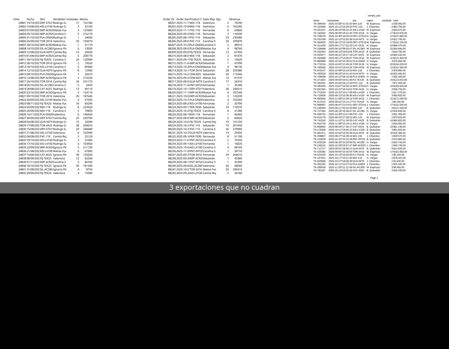

# DiegoAutomatiza — Portfolio de automatización con Python

[](https://github.com/Yeyobitz/diegoautomatiza-portfolio/actions/workflows/ci.yml)

Automatización para PYMEs y operaciones de faena: convierto procesos manuales
en herramientas que corren solas, con datos reales, tests automatizados y
documentación clara. Todos los demos de este repo corren sin argumentos,
incluyen sus datos de ejemplo y pasan CI.

| # | Demo | Qué problema resuelve | Muestra |
|---|------|----------------------|---------|
| 1 | [Conciliador de ventas multicanal](demo1-consolidador/) | Tres exportaciones que no cuadran (Excel, Excel y CSV con formatos distintos) → **un dashboard con KPIs, comparativa por canal y lecturas del mes en 10 segundos**. Detecta duplicados entre canales y deja los errores en una hoja auditable. | [GIF antes/después](demo1-consolidador/capturas/antes-despues.gif) · [Dashboard](demo1-consolidador/capturas/dashboard.png) |
| 2 | [Monitor de precios de catálogo](demo2-scraper/) | Tu competencia cambió precios y tú lo sabes **al día siguiente, no al mes**: corre dos veces y entrega qué subió, bajó, desapareció y apareció, con historial acumulado. Producto vendible como servicio mensual. | [Subieron](demo2-scraper/capturas/captura-03.png) · [Catálogo](demo2-scraper/capturas/captura-01.png) |
| 3 | [Certificados masivos con folio](demo3-plantillas/) | **50 certificados listos para imprimir en ~1 minuto**, con diseño imprimible real (marco ornamental, medallón, firma), folio consecutivo CERT-2026-0001 y registro de emisión. | [Participación](demo3-plantillas/capturas/captura-certificado-participacion.png) · [Distinción](demo3-plantillas/capturas/captura-distincion.png) |
| 4 | [Reporte Diario de Faena](demo4-reporte-faena/) | El jefe de faena dicta por WhatsApp (con sus typos y todo) y el Excel de horas se cruza solo: **reporte formal con HH, avance por frente, incidentes, permisos de trabajo y firmas, listo para el mandante a las 07:00**. El demo donde mi experiencia real en faena industrial chilena se nota. | [Resumen](demo4-reporte-faena/capturas/reporte_faena_2026-11-23-1.png) · [Incidentes](demo4-reporte-faena/capturas/reporte_faena_2026-11-23-2.png) |
| 5 | [Cotizador con folio e IVA](demo5-cotizador/) | Una cotización bien hecha en 30 segundos en vez de 20 minutos copiando de la anterior: **encabezado de empresa, folio consecutivo, IVA 19%, validez y firma bilateral en Excel y PDF**. | [Cotización](demo5-cotizador/capturas/captura-cotizacion-1.png) |
| 6 | [Analizador de asistencia y turnos](demo6-asistencia/) | El cierre de nómina de asistencia toma horas; esto lo deja **listo en segundos desde el CSV del reloj**: tardanzas con tolerancia, horas extra, ausencias y cobertura del mínimo, con detalle auditable. | [Resumen](demo6-asistencia/capturas/resumen_asistencia_2026-11-1.png) · [Cobertura](demo6-asistencia/capturas/resumen_asistencia_2026-11-4.png) |



## Cómo ejecutar un demo

```bash
cd demo1-consolidador        # o demo2-scraper, demo3-plantillas, demo4-reporte-faena
pip install -r requirements.txt
python3 conciliador.py       # scraper.py / generar_certificados.py / reporte_faena.py
```

## Qué demuestra este repo

- **Calidad verificable**: 86 tests automatizados entre los 6 demos, corriendo en CI en cada push.
- **Datos que se ven como negocio real**: ventas de una distribuidora con tres canales, monitoreo de catálogo con detección de cambios, emisión con folio y registro, operación de faena con cuadrillas, permisos (PT) y casi incidentes.
- **Entregables, no scripts sueltos**: cada demo produce el archivo que un cliente abriría en su trabajo (dashboard, reporte de cambios, certificados PDF, reporte formal).
- **Especialidad**: automatización de reportes operativos para construcción e industria (documentos controlados, HH, frentes, prevención de riesgos).

## Cómo contratarme

Servicios disponibles: automatización de Excel y reportes, monitores de precios/catálogo,
documentos masivos con folio, y reportes operativos para faenas.
Contacto: **d.de.diego.dev@gmail.com** (Diego A. Quiñones, Chile — español e inglés).

## Notas técnicas

- Los PDF incluidos son salidas de muestra generadas con LibreOffice (`soffice --headless`).
- Cada demo trae su `requirements.txt`; el demo 2 soporta `file://` para correr sin red y sus tests usan fixtures HTML locales.
- Los datos de ejemplo son ficticios y reproducibles (semilla fija); los nombres de empresas del demo 4 son ficticios.
