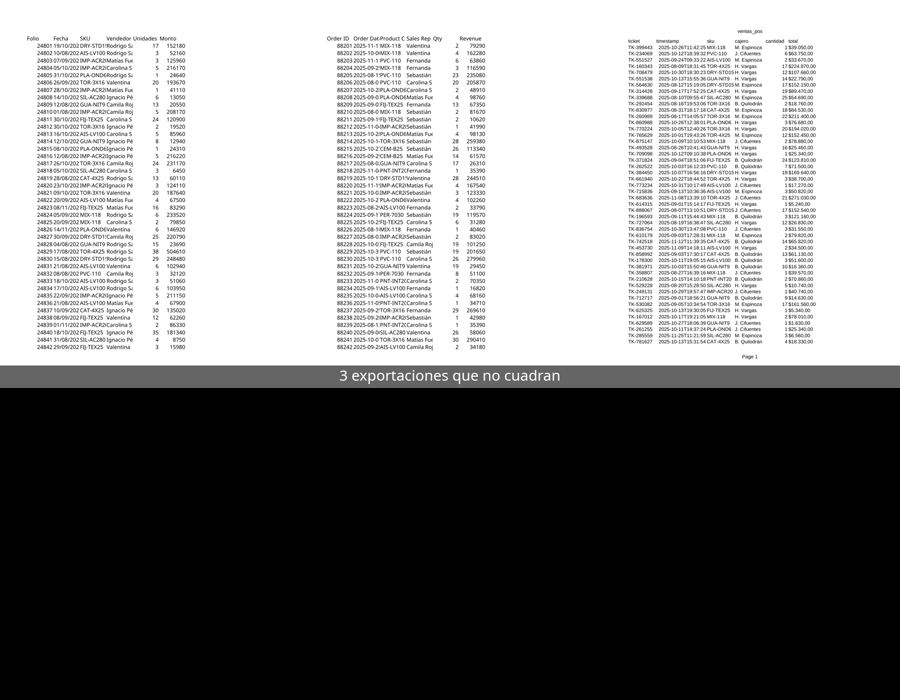

# Demo 1 — Conciliador de ventas multicanal

**Tres exportaciones que no cuadran → un dashboard con KPIs en 10 segundos.**

## El dolor (te suena?)

Todos los lunes llegan al correo tres archivos de ventas que no conversan entre sí:

- El **canal Local** manda un Excel con `Folio, Fecha (dd/mm/aaaa), SKU, Vendedor, Unidades, Monto`.
- El **canal Web** manda otro Excel con `Order ID, Order Date (aaaa-mm-dd), Product Code, Sales Rep, Qty, Revenue`.
- El **POS** manda un CSV con `ticket, timestamp, sku, cajero, cantidad, total` — y los montos vienen como `$1.234,56`, con punto de miles y coma decimal.

Alguien los pega a mano en una planilla maestra. Las columnas no coinciden, las
fechas vienen en dos formatos, los montos del POS hay que reescribirlos uno por
uno, y de paso la misma venta quedó cargada dos veces en dos sistemas — así que
**la suma no cuadra y nadie confía en el número**. Eso es 2 a 4 horas de trabajo
repetitivo, todas las semanas, con riesgo de equivocarse cada vez.

## Qué hace el script

`conciliador.py` toma los tres archivos tal como llegan y entrega
`dashboard_ventas.xlsx` con:

- **Hoja `Dashboard`**: KPIs (ventas totales, transacciones, ticket promedio,
  unidades), Top 5 vendedores con **barras de datos**, comparativa por canal con
  **escala de color neutra** (más azul = más ventas) y **ticket promedio por
  canal**, una sección **"Lectura del mes"** con 3 insights automáticos (variación
  % mensual, canal con mayor caída, producto estrella del período), y **2
  gráficos nativos de Excel** (ventas por mes y ventas por canal) en azul
  corporativo con etiquetas de datos y eje desde $0 — gráficos de verdad,
  editables, no imágenes pegadas.
- **Hoja `Consolidado`**: las 3 exportaciones normalizadas a un esquema común
  (`canal, folio, fecha, sku, vendedor, unidades, monto`), filtrable y ordenada.
- **Hoja `Errores`**: las filas que no sirven (fechas imposibles como
  `32/13/2025`, montos con texto `N/D`) quedan apartadas y etiquetadas, para
  auditarlas con el canal correspondiente — no se borran en silencio.

Además: parsea montos en formato chileno (`$41.990,00` → `41990.0`), detecta
ventas **duplicadas entre canales** (mismo SKU, día, unidades y monto en Local y
Web, por ejemplo, quedó una sola vez) y duplicados exactos dentro de un canal.



## El demo, con números reales

Los datos de ejemplo (`datos/`) simulan una distribuidora de material de
construcción: 15 SKUs de faena (`TOR-4X25`, `DRY-STD15`, `CAT-4X25`,
`IMP-ACR20`...), vendedores con nombre y apellido, cajeros de POS, y meses
cruzados ago–nov 2025. Con una corrida:

```
Resumen de conciliación
  Local: 1915 filas leídas
  Web: 1765 filas leídas
  POS: 1410 filas leídas
  Total leído: 5090 filas
  Errores: 5 (quedan en la hoja Errores)
  Duplicados exactos eliminados: 2
  Duplicados entre canales eliminados: 23
  Ventas totales: $511.544.830
  Transacciones: 5060
  Ticket promedio: $101.096
  Archivo generado: /.../dashboard_ventas.xlsx
```

5.090 filas crudas → 5.060 ventas limpias y conciliadas, con los 5 errores
atrapados en la hoja `Errores` y 23 duplicados inter-canal eliminados.

## Cómo ejecutarlo

```bash
pip install -r requirements.txt
python3 generar_datos.py   # genera los 3 archivos de ejemplo (reproducible, semilla fija)
python3 conciliador.py     # genera dashboard_ventas.xlsx
```

Opcional: apunta a tus archivos reales sin tocar código:

```bash
python3 conciliador.py --local mi_local.xlsx --web mi_web.xlsx --pos mi_pos.csv --salida dashboard.xlsx
```

Captura del dashboard (150 dpi): `capturas/dashboard.png`.

## Tests

23 tests pytest, sin red, con archivos temporales: esquemas distintos → esquema
común, montos chilenos, fechas inválidas, duplicados exactos y entre canales,
KPIs coherentes y una integración end-to-end que valida el Excel generado
(hojas, 2 gráficos, formato condicional y totales).

```bash
python3 -m pytest test_conciliador.py -q   # 23 passed
```

## Estructura

```
demo1-consolidador/
├── conciliador.py        # el programa (normaliza, concilia, exporta dashboard)
├── generar_datos.py      # genera los 3 exportaciones de ejemplo
├── test_conciliador.py   # tests pytest
├── datos/                # ventas_local.xlsx, ventas_web.xlsx, ventas_pos.csv
├── dashboard_ventas.xlsx # salida de la corrida demo
├── capturas/             # antes-despues.gif + dashboard.png (150 dpi)
└── requirements.txt
```

## Por qué sirve como demo de servicio

Cualquier empresa que vende en más de un canal tiene exactamente este problema:
sistemas que no conversan, formatos de monto y fecha incompatibles, ventas
duplicadas y una planilla maestra a mano. Este script lo demuestra en una
corrida de 10 segundos, con errores visibles y auditables — y la misma lógica se
adapta a los canales y esquemas reales del cliente.
