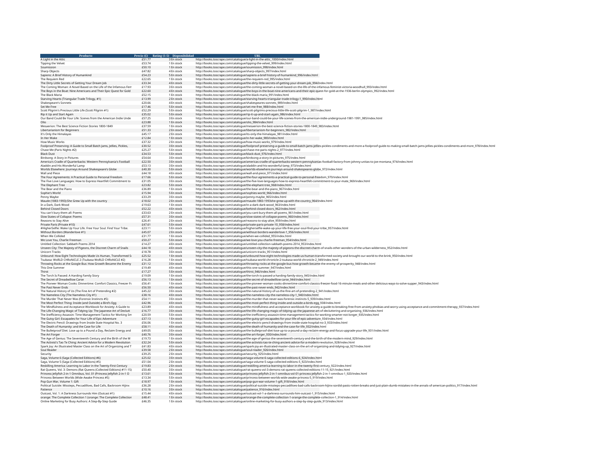
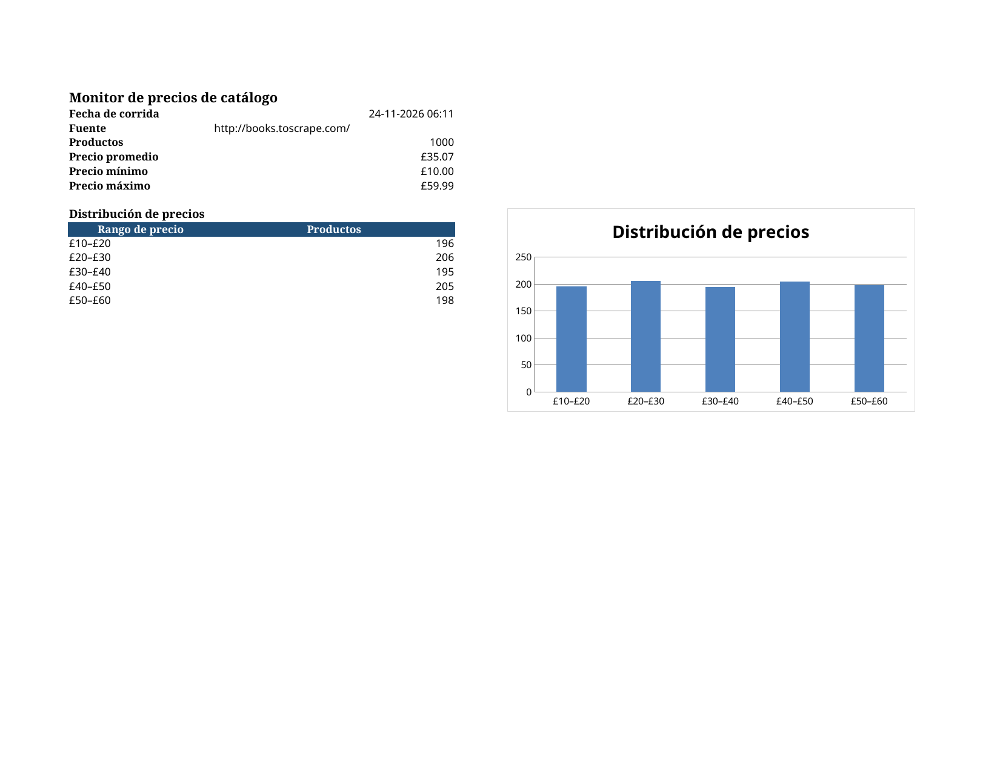
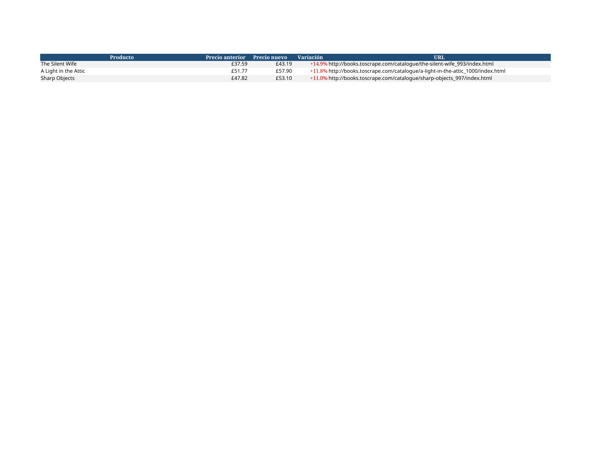
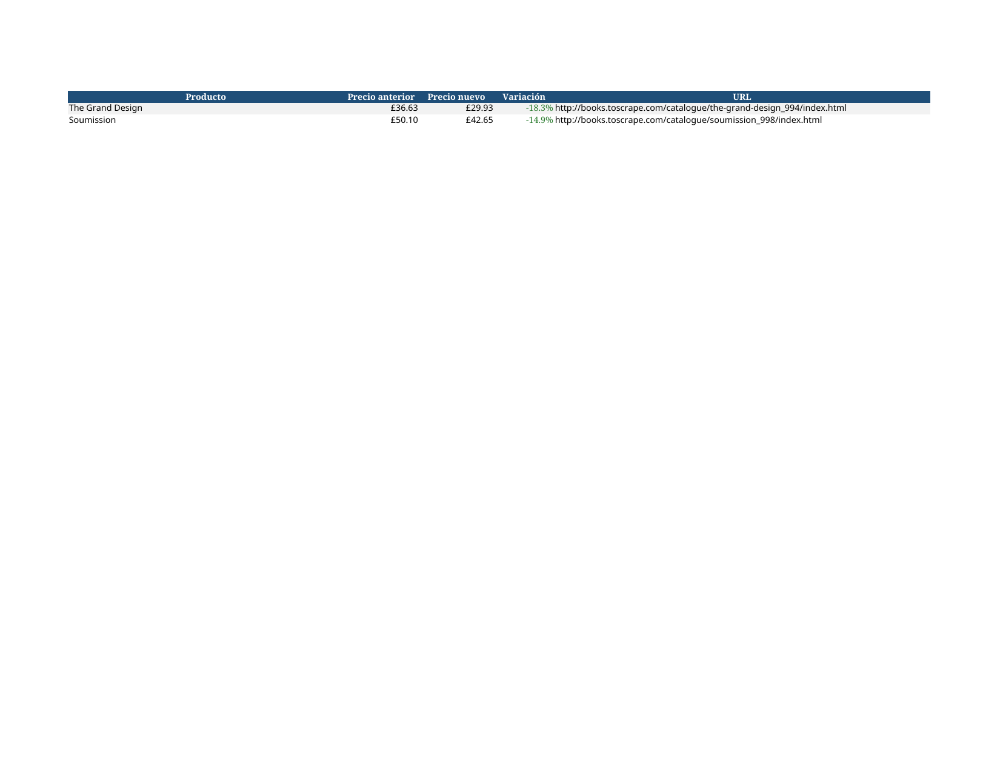

# Monitor de precios de catálogo con detección de cambios

**Tu competencia cambió precios esta mañana. ¿Lo sabes hoy o lo sabes en un mes?**

Revisar los precios de un catálogo a mano significa abrir decenas de páginas,
copiar a una planilla y comparar contra el mes pasado. Nadie lo hace: el
resultado es descubrir una subida de tu proveedor cuando ya perdiste el margen,
o una bajada de la competencia cuando ya perdiste la venta.

Este monitor lo hace solo:

- **Primera corrida** → `catalogo_snapshot.xlsx`: catálogo completo con formato
  profesional (encabezados con relleno, autofiltro, anchos ajustados) y una hoja
  **Resumen** con precio promedio/mínimo/máximo y gráfico de distribución de
  precios.
- **Cada corrida siguiente** → compara contra el snapshot anterior y genera
  `cambios_precios.xlsx` con hojas **Subieron**, **Bajaron**, **Desaparecidos**
  y **Nuevos**, con el **% de variación** de cada producto (subidas en rojo,
  bajadas en verde), ordenado por el movimiento más grande primero.
- **Cada corrida** → deja el snapshot al día y acumula todo en
  `historial_precios.xlsx` (fecha, producto, precio): la evolución completa del
  catálogo, corrida a corrida.

El detalle importa: no es "un Excel de precios", es la **diferencia entre dos
momentos** — exactamente lo que un gerente necesita para reaccionar al día
siguiente y no al mes.

## Cómo se usa

```bash
pip install -r requirements.txt

# 1. Primera corrida: saca el catálogo y crea el snapshot con formato
python3 scraper.py --url http://books.toscrape.com/ --output catalogo_snapshot.xlsx

# 2. Corridas siguientes: compara contra el snapshot anterior
python3 scraper.py --url http://books.toscrape.com/ --compare catalogo_snapshot.xlsx
```

La segunda corrida escribe `cambios_precios.xlsx` y **actualiza el snapshot**
al estado actual: cada ejecución deja todo listo para la siguiente. El
historial completo queda en `historial_precios.xlsx`.

`--url` también acepta rutas locales (`file:///ruta/catalogo.html`) para probar
el flujo completo sin conexión.

## Monitor repetible (cron)

Una línea en el crontab y el cliente recibe el archivo de cambios de hoy cada
mañana, sin que nadie abra el sitio:

```cron
# 07:00 todos los días: scrapear, comparar contra el snapshot anterior, dejar todo al día
0 7 * * * cd /ruta/al/monitor && python3 scraper.py --compare catalogo_snapshot.xlsx && cp cambios_precios.xlsx cambios_$(date +\%F).xlsx
```

- `cambios_2026-11-24.xlsx` = qué cambió hoy respecto de ayer.
- `historial_precios.xlsx` = evolución completa desde el primer día.
- Con un `mutt` o `mail` después del `cp`, el reporte llega por correo al
  gerente antes de que tome el primer café.

Montado como servicio para PYMEs: instalación inicial + reporte diario por
correo, $50-150/mes por catálogo monitoreado.

## Qué librerías usa

- **requests + beautifulsoup4** — recorre las páginas de listado (50 en vez de
  las 1.000 de detalle: 20× menos requests), maneja errores de red con mensajes
  claros.
- **openpyxl** — snapshots y reportes de cambios con formato profesional y
  gráficos, listos para presentar.

## Detalles técnicos

- Paginación automática siguiendo el enlace `next`; deduplicación por URL.
- Precios con símbolo de moneda parseados a número (`£51.77` → `51.77`),
  ratings como clase CSS ("Three" → 3), disponibilidad "In stock"/"Out of
  stock" → "En stock"/"Agotado".
- La comparación usa la URL como clave estable del producto; `% variación` =
  (nuevo − anterior) / anterior.
- Modo `file://` para correr el flujo completo sin red (demo y CI).
- **9 tests con pytest sobre fixtures HTML locales** — el pipeline se prueba
  sin depender de la red ni del sitio (roda en CI).





