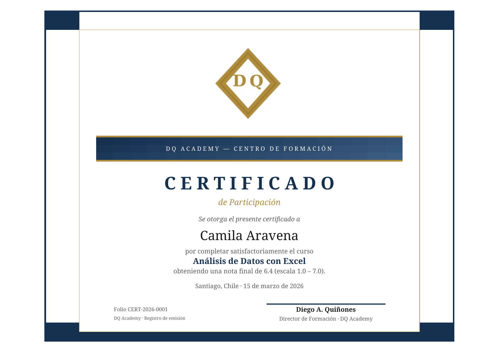

# Demo 3 — Certificados masivos con folio y registro

> **50 certificados listos para imprimir en un minuto, con folio y registro.**
> Medido en esta máquina: 50 participantes → 50 Excel + 50 PDF + registro de emisión en **56 segundos**.

**El dolor que resuelve:** cerrado el curso, alguien tiene que emitir un
certificado por participante: abrir una plantilla, tipear nombre, curso, fecha
y nota, guardar como PDF con un nombre decente, y anotar en alguna planilla qué
se entregó y con qué número. Son **15 minutos por certificado** — un curso de
50 personas es un día de trabajo con errores de tipeo, folios repetidos y
ningún registro de qué se emitió.

Este script lo baja a **un comando y un minuto**:

```bash
python3 generar_certificados.py --input participantes.csv --output emitidos/
```

| Antes | Después |
|---|---|
| 15 min por certificado, copiando y pegando | 50 certificados en ~56 s, sin tocar nada |
| Word + guardar como PDF uno por uno | Cada Excel sale con su PDF listo para imprimir |
| "¿Qué número le tocó a Juan?" — nadie sabe | Folio consecutivo `CERT-2026-0001` por certificado |
| Sin constancia de qué se emitió | `registro_emision.xlsx` con folio, nombre, curso, fecha, fecha de emisión y archivo |
| El mismo diseño para todos, aunque sea un premio | Dos plantillas: **Certificado de Participación** y **Distinción al Mejor Participante** |
| Re-emitir reinicia numeración o duplica folios | Si el registro existe, la numeración **continúa** donde quedó |




## El diseño (lo que la gente ve)

Las plantillas no son una planilla con bordes: son un **documento imprimible**
armado celda a celda con openpyxl — página A4 horizontal, doble marco
ornamental con esquinas en bloque, banda superior con degradado escalonado
enmarcada en filetes dorados y con el nombre de la academia en serif blanco
con tracking, medallón monograma "DQ" en rombo dorado, título en serif 30 pt
con tracking, línea de firma con aclaración del cargo, folio y ciudad/fecha.
Los participantes van en el CSV; el diseño vive en `plantillas/` y nadie lo
toca al emitir.

## Entrada: un CSV

```csv
nombre,curso,fecha,nota,tipo
Camila Aravena,Análisis de Datos con Excel,2026-03-15,6.4,participacion
Antonia Vega,Análisis de Datos con Excel,2026-09-13,7.0,distinción
```

- `tipo` acepta `participacion` / `distincion` (con o sin tilde).
- Fechas ISO o día-primero; salen en el certificado como "15 de marzo de 2026".
- Cada fila inválida (nombre vacío, nota no numérica, fecha mala) detiene la
  corrida con un mensaje que dice **fila y columna exactas** del problema.

## Salida: carpeta lista para imprimir

```
emitidos/
├── CERT-2026-0001_camila_aravena.xlsx
├── CERT-2026-0001_camila_aravena.pdf   ← listo para imprimir/enviar
├── ...
├── DIST-2026-0001_antonia_vega.pdf
└── registro_emision.xlsx               ← qué se emitió, cuándo y con qué folio
```

## Opciones

```bash
--input CSV            # lista de participantes (default: participantes.csv)
--output DIRECTORIO    # a dónde dejar todo (default: .)
--plantilla DIRECTORIO # carpeta con las plantillas (default: ./plantillas;
                       #   si no existe, se genera sola)
```

Los PDF requieren LibreOffice (`soffice`) en el PATH.

## Tests

```bash
python3 -m pytest test_generar_certificados.py -v
```

9 tests cubren: folios únicos y consecutivos (y que continúan al re-emitir),
marcadores `{{...}}` reemplazados sin dejar rastro, CSV malformado rechazado
con mensaje de fila, plantilla inexistente, PDF existente y no vacío, registro
completo y formato largo de fecha. Corren en ~20 s, sin red.

## Detalles técnicos

- **openpyxl** — plantillas de diseño (rellenos escalonados, marcos, merges) y
  reemplazo de marcadores conservando todo el formato.
- **pandas** — lectura y validación del CSV de participantes.
- **LibreOffice headless** — conversión individual a PDF por certificado.
- Los folios viven en `registro_emision.xlsx`: re-emitir en la misma carpeta
  retoma la numeración desde el último folio de cada tipo.
- Reutilizable para constancias, diplomas de asistencia o invitaciones:
  cambia la plantilla y el CSV, no el código.
